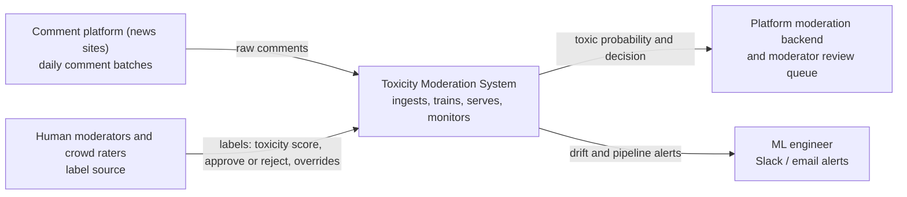
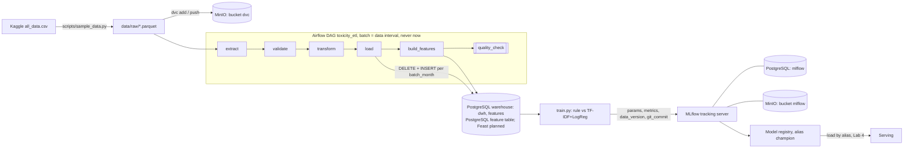
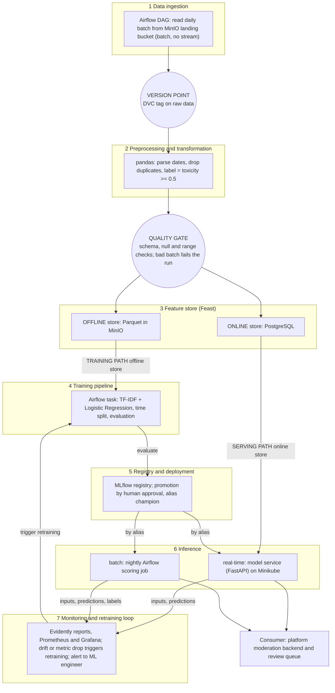
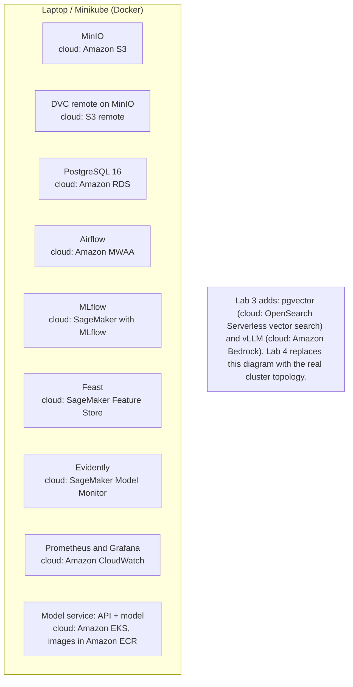

# Design Document: Toxic Comment Moderation System

Dataset: Jigsaw Unintended Bias in Toxicity Classification all_data.csv, Kaggle.
https://www.kaggle.com/competitions/jigsaw-unintended-bias-in-toxicity-classification/data

## 1 Overview

Social media get thousands of comments every day and human moderators simply cannot read all of them. For this reason, this project builds a system that scores every added comment for toxicity, sends unclear cases for human moderation, watches for drops in quality and retrains the model when the data changes. The goal is that most toxic comments are caught before readers see them, while moderators only review a small part of the comments instead of all of them.

## 2 Motivation

Who consumes predictions?
The moderation backend of a news-comment platform. It calls the system for every new comment.

How often?
Online: once per new comment, answer in under 200 ms. Batch: once per night, to re-score recent comments and to compute monitoring reports.

What happens when the system is wrong?

- FN: readers are hurt, may leave.
- FP: a user is silenced by mistake, trust in the platform goes down.
  A missed toxic comment is worse for readers, a wrongly hidden comment is worse for free speech. That is why the system uses three outcomes (publish / human review / hide) and not just yes-no.

Why a system and not a notebook?
Comments arrive every day, the language changes, and the model gets worse over time without anyone noticing. We need versioned data, repeatable training, a service that answers fast, and monitoring that tells a human when something changes.

## 3 Success metrics

| Layer               | Metric                                                                   | Target           |
| ------------------- | ------------------------------------------------------------------------ | ---------------- |
| Business / decision | Share of toxic comments that stay visible to readers (missed-toxic rate) | <= 25%           |
| Business / decision | Share of all comments sent to human review                               | <= 15%           |
| Model               | PR-AUC on the toxic class (optimizing metric)                            | >= 0.60          |
| Model               | Precision at the chosen threshold (satisficing metric)                   | >= 0.50          |
| Model               | Recall on the toxic class at that threshold                              | >= 0.70          |
| System              | p95 latency of the prediction API                                        | <= 200 ms        |
| System              | Data freshness (new comments scored and visible in monitoring)           | <= 24 hours      |
| System              | API availability                                                         | >= 99% per month |

## 4 Requirements and constraints

## 4.1 Functional requirements

- Input: a comment: id, comment_text, publication_id, optional parent_id.
- Output: toxic_probability (0 to 1), decision (publish, review, or hide), model_version.
- Who calls: the platform's moderation backend through POST /predict (online). An Airflow job calls the same model for nightly batch scoring.
- Decision rule: probability >= 0.90 -> hide (and stays in review for a human check); 0.40 to 0.90 -> review; below 0.40 -> publish.
- Labels in: human moderators decisions come back daily and are used for evaluation and retraining.
- Alerts out: drift and pipeline alerts go to the ML engineer.

## 4.2 Non-functional requirements

| Category                           | Requirement                                                                                                                                                                                                                                               |
| ---------------------------------- | --------------------------------------------------------------------------------------------------------------------------------------------------------------------------------------------------------------------------------------------------------- |
| Freshness                          | New comments are ingested daily and visible in features and monitoring within 24 h. The online feature publication_toxic_rate_7d is updated once per day.                                                                                                 |
| Latency and throughput             | p95 <= 200 ms per comment. Designed for 20 requests/s peak.                                                                                                                                                                                               |
| Availability and fallback          | 99% per month. If the model is not available, the service falls back to the word-list rule baseline. If the whole service is down, the platform sends the comment to the human review queue.                                                              |
| Reproducibility                    | Python environment pinned in uv.lock. Data versioned with DVC. Every MLflow run stores the data version, git commit and random seed. A registered model can be rebuilt with one command.                                                                  |
| Adaptability                       | New data enters as monthly batches through the Airflow DAG. A new model is trained monthly or when a drift alert fires. It is promoted only if it beats the current model on the newest hold-out.                                                         |
| Observability without ground truth | Labels arrive late, so we watch: input drift (text length, share of unknown words, publication mix), prediction drift (share predicted toxic, score distribution), share of comments in the review queue, and the fast rating signal (approved/rejected). |
| Cost and resource ceilings         | Local run: one laptop, Minikube with 4 GB. Cloud estimate in 6.7; assumed budget ceiling 630 USD/month.                                                                                                                                                   |

Conflict between two requirements. Recall conflicts with precision. Recall is pushed up until precision hits the 0.50 floor, so precision floor wins, because wrongly hiding comments harms user trust.

## 4.3 In scope

- English text comments, toxic / not toxic.
- Daily batch ingestion, online prediction API, nightly batch scoring.
- Drift monitoring and retraining with a human approving promotion.

## 4.4 Out of scope

- Images, video, audio and other languages.
- User appeals and user reputation systems.
- Real production deployment and real traffic (everything runs locally).
- Streaming ingestion (Kafka/Spark).

## 5

### 5.1 Problem statement

Framing: binary text classification. A comment is toxic if the toxicity score is >= 0.5. The model outputs a probability, and thresholds turn it into one of three decisions.

Rejected framing: regression on the raw toxicity score. The score is the share of raters who agreed, not a real level of toxicity. Predicting it exactly is hard and not useful, because we only need a decision. A classifier with thresholds is simpler to evaluate, monitor and explain.

### 5.2 Data

Source
Kaggle "Jigsaw Unintended Bias in Toxicity Classification", about 1999516 public comments from news sites from 2015-09-29 to 2017-11-11. Fields: comment_text, created_date, publication_id, parent_id, toxicity (label), rating.
License: CC0

Class balance. 7.99% of comments have toxicity >= 0.5 (strong imbalance). rating is 93.4% approved and 6.6% rejected.

Arrival pattern. Batches. The data has dates, so we replay it month by month. Production would send a daily batch.

Labels and their delay:

- rating (approved/rejected by platform moderation) arrives within hours. It is a fast, noisy proxy.
- Gold toxicity labels (crowd raters plus moderator review) arrive about 7 days after publication, for a sample (about 5% of comments).
- Lab 4 monitoring uses proxy signals in these first 7 days and true metrics after that.

Available at serving time and training time.

- Serving: comment_text, publication_id, parent_id, plus Feast online features.
- Only at training time: toxicity score and all subtype scores, annotator counts, identity columns, reactions.
- Not used as features: reactions appear only after publication and would leak the future. Identity columns exist only for part of the rows and are used only for fairness checks. The Kaggle split column is ignored because we split by time.

Sampling
up to 25000 comments per month (random inside each month). Months before 2016-03 have fewer than 5000 comments each, so drop them. Month 2017-11 is incomplete (ends on Nov 11).

Checklist justification

1. Time axis: yes. created_date covers 2015-09 to 2017-11, so can replay the next month in Lab 2 and inject drift in Lab 4. Weakness: real language drift in 2016-2017 news comments is mostly about topics (politics, elections), not new slang, so Lab 4 will add a synthetic shift (for example obfuscated spellings), this shift is synthetic.
2. History to hold out: 21 usable months (2016-03 to 2017-11), more than 2.0M rows in total. Plan, by time:
   - Train: 2016-03 to 2017-03.
   - Validation (hold-out): 2017-04 to 2017-05.
   - "New batches" for Lab 2 and 4: 2017-06, 2017-07, 2017-08, one per month.
   - Final test, never used for tuning: 2017-09 to 2017-10.
   - Spare / drift experiments: 2017-11 (partial).
3. Label delay: stated above (hours for rating, about 7 days for gold labels; both are assumptions).
4. Text surface and corpus: the comments themselves are the text. For the Lab 3 retrieval corpus will be used public community guidelines: Wikipedia civility policy, Reddit Content Policy and YouTube Community Guidelines. The LLM will use them to explain which rule a flagged comment breaks.

### 5.3 Techniques

Baseline 0 (rule): a list of offensive words; a comment is toxic if it contains one. Very cheap and easy to explain. Also used as the fallback when the model service is down.

Baseline 1 / production candidate (Labs 2 to 4): TF-IDF + Logistic Regression (class-weighted for the 8% imbalance). It trains in minutes on a laptop, runs in a few ms on CPU, and any reviewer can rebuild it from the repo.

Possible later upgrade (not required): a small transformer (DistilBERT). Rejected for now, see 7.1.

Features and where they come from at serving time

| Feature                                                                                    | Training source                            | Serving source                                                      |
| ------------------------------------------------------------------------------------------ | ------------------------------------------ | ------------------------------------------------------------------- |
| Word and character n-gram TF-IDF of comment_text                                           | computed from the training text            | computed from the request text with the same saved sklearn pipeline |
| text_length, upper_case_ratio, exclamation_count                                           | computed from the training text            | computed on the fly from the request text                           |
| is_reply (parent_id is not empty)                                                          | parent_id column                           | parent_id in the request body                                       |
| publication_id                                                                             | column                                     | request body                                                        |
| publication_toxic_rate_7d (share of toxic comments in this publication in the last 7 days) | Feast offline store, point-in-time correct | Feast online store, refreshed once a day                            |

The last feature has different training and serving sources, so it is the place where training-serving skew could enter: handled by building both sides from the same Feast definition and checking they agree in a test.

### 5.4 Experimentation and validation

- Split by time, never random: train on the earlier months, validate on later months. A random split would put comments from the same news story, and the same slang of the same week, into both train and test. The model would look better offline than it is in the future. A time split prevents this leak.
- Offline metrics: PR-AUC (main), recall at precision >= 0.50, and false-positive rate on comments that mention identity groups (religion, race, gender) as a fairness check.
- Comparing a new model with the current one: both are evaluated on the same newest hold-out. The new model is promoted only if: PR-AUC is at least 0.01 higher; recall at precision 0.50 is not lower; the false-positive rate for identity-mention comments does not grow by more than 10% relative; p95 latency stays ≤ 200 ms.
- What should catch "offline gets better, business gets worse": the identity-group check and the review-queue-share check, plus using the newest months as hold-out, so the model is tested on data close to what it will see.

### 5.5 Human in the loop

- Drift alert: goes to the ML engineer, who checks the Evidently report and decides if retraining is needed.
- Model promotion: a human approves moving the alias champion in the MLflow registry after the rules in 5.4 pass. Promotion is never automatic.
- Override: a moderator can overturn any decision (hide -> publish, or the reverse). The override is stored with the comment id and becomes a gold label for the next retraining. A high share of overrides is also a monitoring signal.

## 6

### 6.1 High-level design

#### Diagram 1: System context

#### Diagram 1 (iteration 2): System context

#### Diagram 2: Data flow on the seven layers

### Diagram 3: Deployment, first draft

## 6.2 Infra

Cloud provider chosen for the estimate: AWS

| Component                              | Local                                                        | AWS (managed equivalent)            | GCP                                      | Azure                          |
| -------------------------------------- | ------------------------------------------------------------ | ----------------------------------- | ---------------------------------------- | ------------------------------ |
| Object storage, data lake              | MinIO-compatible (pgsty/silo)                                | Amazon S3                           | Cloud Storage                            | Blob Storage                   |
| Data versioning remote                 | DVC with dvc-s3, remote on MinIO                             | S3 remote                           | GCS remote                               | Azure Blob remote              |
| Warehouse, serving database            | PostgreSQL 16                                                | Amazon RDS                          | Cloud SQL                                | Azure Database for PostgreSQL  |
| Orchestrator                           | Apache Airflow 3.3.1 (LocalExecutor)                         | Amazon MWAA                         | Cloud Composer                           | Azure Data Factory             |
| Experiment tracking and model registry | MLflow 3.16.1 (PostgreSQL backend, MinIO artifacts)          | SageMaker with MLflow               | Vertex AI Experiments and Model Registry | Azure ML with MLflow           |
| Feature store                          | Feast 0.66.0 (offline: Parquet on MinIO; online: PostgreSQL) | SageMaker Feature Store             | Vertex AI Feature Store                  | Azure ML managed feature store |
| Model and data monitoring              | Evidently                                                    | SageMaker Model Monitor             | Vertex AI Model Monitoring               | Azure ML model monitoring      |
| Metrics store and dashboards           | Prometheus, Grafana                                          | Amazon CloudWatch                   | Cloud Monitoring                         | Azure Monitor                  |
| Container registry                     | Minikube built-in registry                                   | Amazon ECR                          | Artifact Registry                        | Azure Container Registry       |
| Kubernetes cluster / model service     | Minikube (Kubernetes 1.30.0, 4 GB)                           | Amazon EKS                          | GKE                                      | AKS                            |
| Vector store (from Lab 3)              | pgvector                                                     | OpenSearch Serverless vector search | Vertex AI Vector Search                  | Azure AI Search                |
| LLM inference (from Lab 3)             | vLLM or an API                                               | Amazon Bedrock                      | Vertex AI generative AI                  | Azure OpenAI                   |

### 6.3 Performance

- Latency budget: p95 <= 200 ms per comment. TF-IDF + Logistic Regression needs a few milliseconds on CPU, so there is a lot of room.
- Throughput budget: 20 requests/s peak.
- Batch vs online: hybrid.
  - Online for new comments, because a toxic comment should not be visible while waiting for a nightly job.
  - Batch for the daily data load, nightly re-scoring and monitoring reports, because these are not time-critical and are cheaper and simpler to run as jobs.
- Features are cheap to compute; only one feature (publication_toxic_rate_7d) is read from the online store.

### 6.4 Security

- Secrets (MinIO and PostgreSQL passwords, API key) live in a local .env file that is in .gitignore. In Lab 4 they move to Kubernetes Secrets. In the cloud they would be in AWS Secrets Manager.
- Only the platform's moderation backend may call the prediction API; it must send an API key in a header. Airflow, MLflow and MinIO consoles are reachable only from localhost / inside the cluster.

### 6.5 Data privacy

- The dataset holds public comments without usernames, but the comment text can still contain names or other personal details.
- Raw data stays in the project's MinIO bucket only, and not published in the git repository (only DVC pointer files).
- Retention: raw and processed data kept until the end of the course. In a real system: request logs kept 30 days and only comment ids (not text) kept in monitoring tables.

### 6.6 Monitoring and alarms

every request id, model version, toxic probability, decision, latency; every pipeline run with row counts and the partition date it read is logged.

Metrics and alerts

| Signal                                                                                                                                                    | Threshold (Assumption)         | Receiver    |
| --------------------------------------------------------------------------------------------------------------------------------------------------------- | ------------------------------ | ----------- |
| Input drift: PSI on text length, share of unknown words, publication mix                                                                                  | PSI > 0.2                      | ML engineer |
| Prediction drift: share predicted toxic vs 7-day average                                                                                                  | relative change > 50%          | ML engineer |
| Review-queue share                                                                                                                                        | > 25% of comments              | ML engineer |
| Proxy metric: rejected rate in rating                                                                                                                     | relative change > 30%          | ML engineer |
| True recall / PR-AUC when labels arrive (about 7 days late)                                                                                               | below the targets in section 3 | ML engineer |
| Stale output: the pipeline reports success, but the latest processed partition date did not move for 36 h, or two runs in a row have identical row counts | any                            | ML engineer |
| p95 latency and error rate                                                                                                                                | > 200 ms, or > 1% errors       | ML engineer |

Lab 4 turns this into real Evidently reports, Prometheus metrics and Grafana alerts.

### 6.7 Cost

region US East (N. Virginia)

| Service                         | Assumption                                        | About USD / month |
| ------------------------------- | ------------------------------------------------- | ----------------- |
| Amazon S3                       | 50 GB of data, few requests                       | 1.15              |
| Amazon RDS (PostgreSQL)         | small instance, 20 GB                             | 23.36             |
| Amazon MWAA                     | smallest environment, always on                   | 360.37            |
| SageMaker with MLflow, training | one tracking server, 4 training runs of about 1 h | 72                |
| SageMaker Feature Store         | small online store                                | 0.45              |
| Amazon EKS                      | control plane + 2 small nodes                     | 146               |
| Amazon ECR, CloudWatch          | small                                             | 1.5               |
| Amazon Bedrock (from Lab 3)     | few thousand short calls (Anthropic)              | 22                |
| Total                           |                                                   | about 627         |

Largest item: MWAA

### 6.8 Integration points

- Upstream (data): the comment platform's data team sends a daily file. Contract: Parquet/CSV with at least id, comment_text, created_date, publication_id, parent_id; one file per day; delivered before 06:00 UTC. If the schema changes, the quality gate in layer 2 fails the run, nothing goes to the feature store, and the ML engineer gets an alert; the old model keeps serving.
- Upstream (labels): moderators export their decisions daily (id, label, decision_time).
- Downstream (predictions): the platform's moderation backend. Contract: POST /predict with {id, comment_text, publication_id, parent_id}, answer {id, toxic_probability, decision, model_version} within 200 ms p95. Breaking changes to this format need a new version of the API (/v2/predict).

### 6.9 Risks and uncertainties

| Risk                                                                  | Mitigation                                                                                                |
| --------------------------------------------------------------------- | --------------------------------------------------------------------------------------------------------- |
| Language drift (new slang, spelling tricks to avoid filters)          | Drift monitoring on input text; retrain on newest data; inject synthetic shift in Lab 4 to test the alert |
| Real drift in this dataset is weak (2016 to 2017 news comments)       | Say so openly; use synthetic shift as a test, not as a claim about reality                                |
| Class imbalance (8% toxic)                                            | Class weights, PR-AUC instead of accuracy                                                                 |
| Bias against comments that mention identity groups                    | Fairness check in 5.4 on every promotion                                                                  |
| Wrongly hidden comments (false positives)                             | Three-way decision with a human review queue                                                              |
| Labels arrive late                                                    | Proxy metrics (rating, prediction drift) in the meantime                                                  |
| Source schema changes without notice                                  | Quality gate fails the run; old model keeps serving                                                       |
| Feature skew between training and serving (publication_toxic_rate_7d) | Same Feast definition for both sides; consistency test                                                    |
| Cloud cost higher than estimated                                      | Cost estimate is revisited each lab; cheaper orchestrator option                                          |

## 7

### 7.1 Alternatives

| Alternative                                                                              | Pros                                         | Cons                                                                                                 | Why rejected                                                                                                                             |
| ---------------------------------------------------------------------------------------- | -------------------------------------------- | ---------------------------------------------------------------------------------------------------- | ---------------------------------------------------------------------------------------------------------------------------------------- |
| DistilBERT fine-tuning instead of TF-IDF + LR                                            | Usually higher accuracy; understands context | Needs a GPU or is slow on CPU; harder to rebuild; higher serving cost and latency                    | The course grades reproducibility, not accuracy. A simple model any reviewer can run is better for this project. Can be a later upgrade. |
| Streaming ingestion (Kafka + Spark) instead of daily batches                             | Lower freshness delay (seconds)              | More moving parts, much more local resource use; the dataset is a historical file, not a live stream | Freshness of 24 h is enough for monitoring, and prediction is already online through the API.                                            |
| External moderation API (for example a hosted toxicity service) instead of our own model | No training work; fast to start              | No control over versions or data; cost per call; cannot adapt to our data; no drift story            | The goal of the course is to build and operate the full ML system.                                                                       |
| Other dataset (Twitter hate-speech sets)                                                 | Social-media style text                      | Usually no reliable timestamps and a small size                                                      | This one has dates and about 2M rows, so a time split is possible.                                                                       |

### 7.2 Experiment results (MLflow, experiment toxicity-baseline)

| Run                           | Kind  | PR-AUC | recall@p≥0.5 | Run id                           | Registered                           |
| ----------------------------- | ----- | ------ | ------------ | -------------------------------- | ------------------------------------ | --- |
| rule-badwords                 | rule  | 0.2853 | 0.1098       | 84ce613f86994dd8b840464b8d40d3dd | no                                   |
| tfidf-lr                      | model | 0.6561 | 0.7172       | 634c9446af784343b4b73788bff7f11e | toxicity-tfidf-lr v1, alias champion |
| tfidf-lr RANDOM SPLIT (leaky) | model | 0.6512 | 0.6979       | 25ad3577cf704e5881196a72e7ba193d | never                                |     |

### 7.3

placeholder for lab 3

### 7.4 Milestones

- Lab 2: Version the data with DVC, build an idempotent Airflow pipeline with a quality gate, and track the baseline training runs and a registered model in MLflow.
- Lab 3: Add an LLM component that retrieves the right community-guideline rule from a pgvector index and explains why a comment was flagged, with evaluation, versioned prompts, and cost and latency recorded.
- Lab 4: Containerize the model service, deploy it on Minikube with health checks, schedule Evidently monitoring with Prometheus and Grafana, and show an injected shift triggering an alert.
- Lab 5: Add an agent that helps a moderator by calling the model, retrieving the guidelines and drafting a decision note, with saved traces and a ten-task evaluation.

AI usage report: asked in-vs code copilot to polish grammar in texts
